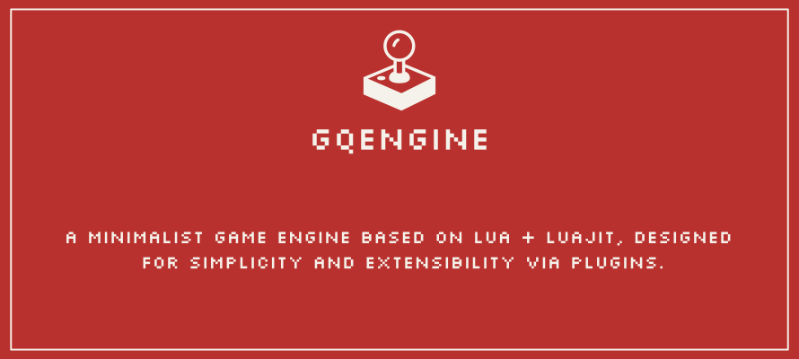

   

<h2 align="center">Overview</h2>
GQEngine is an ultra-minimalist game engine built with:
- **Lua/LuaJIT** for scripting and game logic
- Direct **FFI bindings** to SDL3
- A **plugin system** for extensibility
- **Event-driven architecture** for decoupling

Ideal for rapid prototyping, simple 2D games, and experimenting with engine design.

<h2 align="center">Features</h2>

| Feature         | Status  | Description                                       |
| --------------- | ------- | ------------------------------------------------- |
| Event Bus       | Planned | Event system: `on_load`, `on_update`, `on_render` |
| Plugin Manager  | Planned | Dynamic loading of Lua plugins                    |
| Graphics Plugin | Planned | Rendering of images, primitives, and text         |
| Window Plugin   | Planned | Single-window support via SDL3                    |
| Input Plugin    | Planned | Keyboard, mouse (controllers: future)             |
| Audio Plugin    | Planned | Sound and music support                           |
