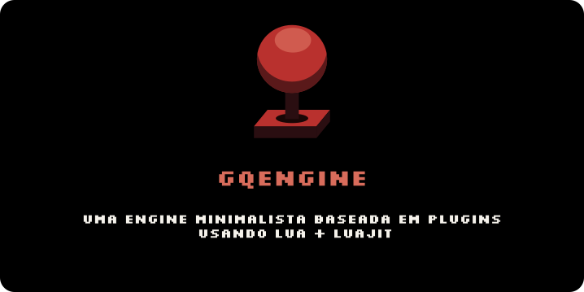

<h1> Visão Geral</h1>

A GQEngine é desenvolvida com foco em minimalismo usando:

- **Lua/LuaJIT** para lógica da engine e jogos
- **SDL3** via bindings com **FFI**
- Sistema plugins com **arquitetura microkernel**
- Gerenciamento de eventos para ciclo de vida dos plugins

## Características

- [ ] Host de plugins
- [ ] Gerenciamento de eventos
- [ ] Plugin da janela principal
- [ ] Plugin de gráficos
- [ ] Plugin de entradas
- [ ] Plugin de imagens
- [ ] Plugin de audio

> **Acompanhe o desenvolvimento**
>
> Você pode acompanhar como cada sistema está sendo desenvolvido no site oficial do [Game Quest Studio](https://gamequeststudio.com.br).